# Finance Controller

Controle financeiro pessoal **local-first**: um app **desktop (Electron)**, um **app Android** que
sincroniza com o desktop e um **servidor MCP** para assistentes de IA operarem os dados.
O usuário é dono dos dados: tudo roda sobre um PostgreSQL próprio, sem servidor de aplicação.

> **Repositório de portfólio.** Esta é a vitrine pública: mostra a **arquitetura** e o **núcleo testado**
> (domínio e casos de uso), não o produto inteiro. O app completo (desktop, Android, MCP, sync, empacotamento)
> é comercializado e vive em repositório privado. Licença não comercial — veja [LICENSE](LICENSE).

## Em funcionamento

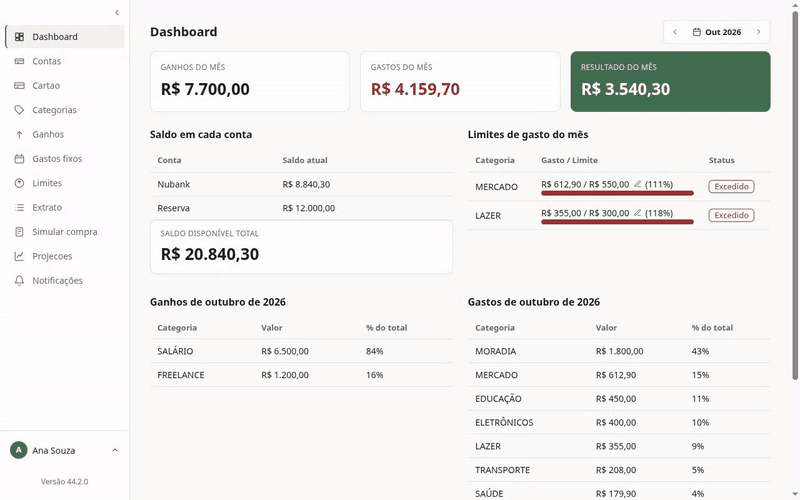

| Dashboard | Extrato |
|---|---|
| 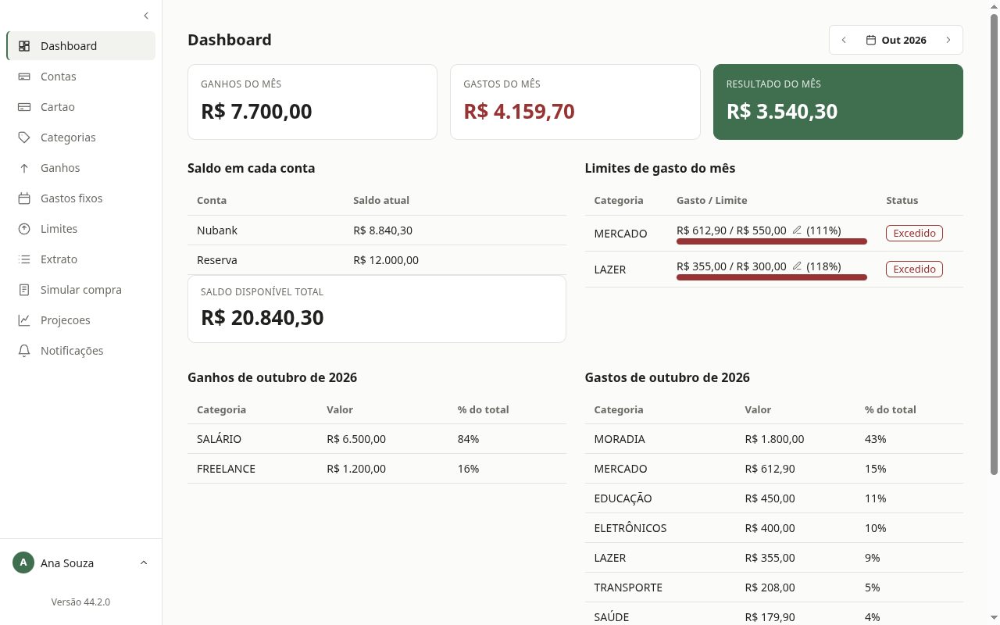 | 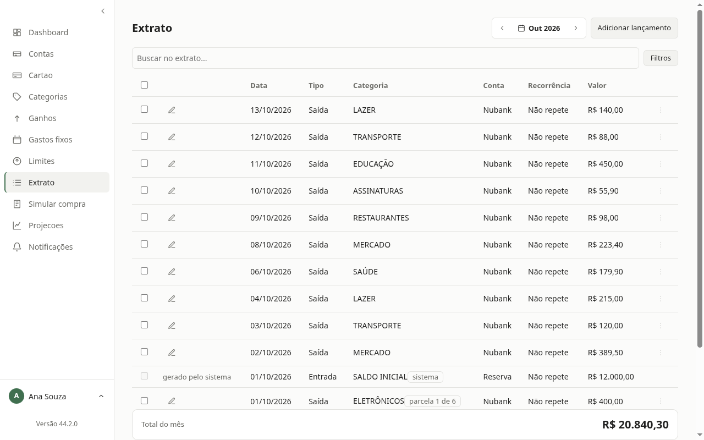 |
| **Limites de gasto** | **Gastos fixos** |
| 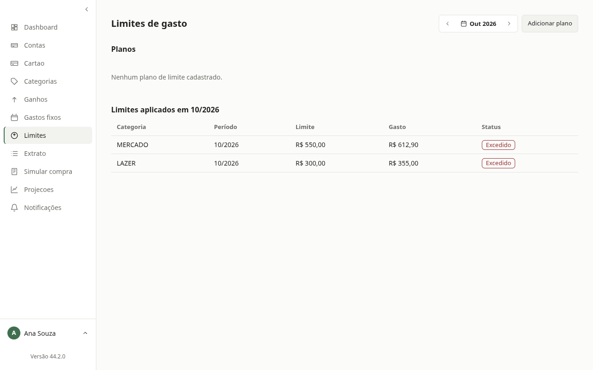 | 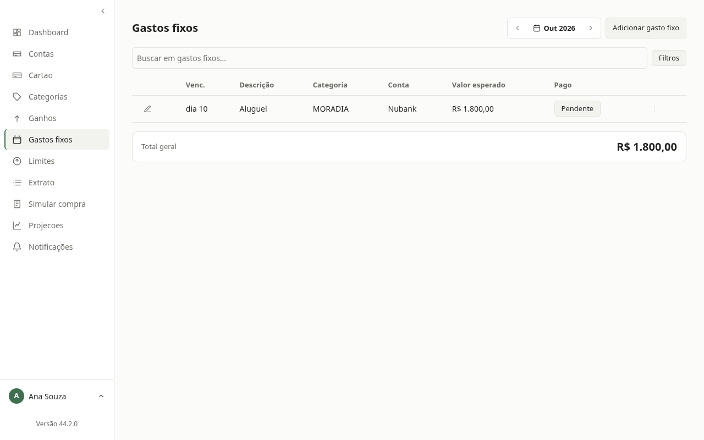 |
| **Cartão de crédito** | **Projeções** |
| 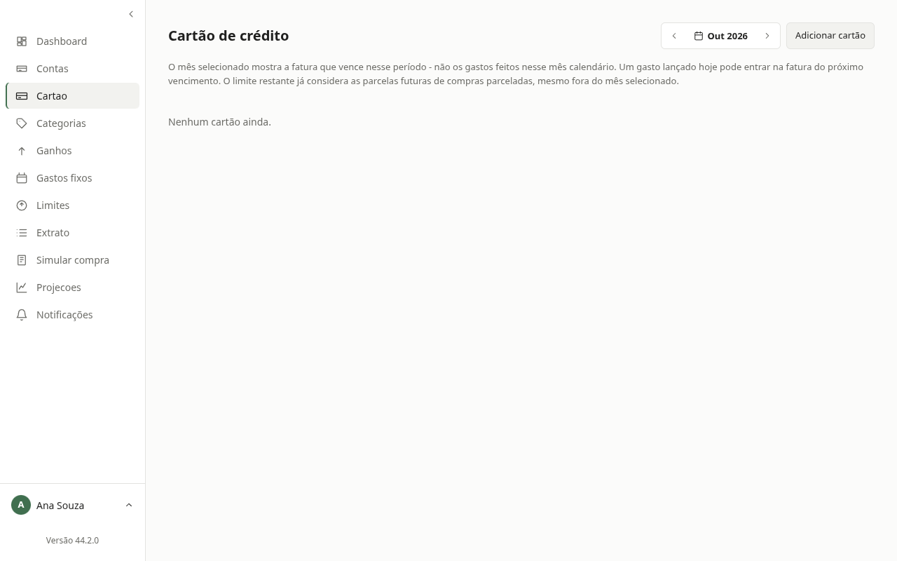 | 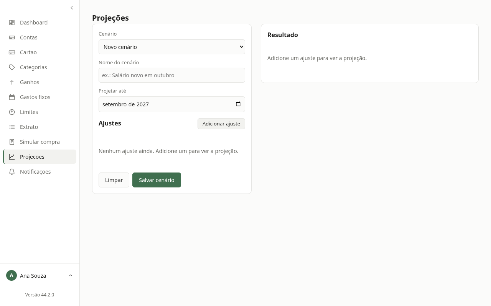 |

<!-- TODO: android-*.png/gif e mcp-assistente.gif quando houver captura no aparelho -->

## O que o produto faz

- **Desktop**: contas, ganhos, gastos fixos, cartões com compras parceladas, limites de gasto,
  categorias (renomear propaga), recorrência com materialização, previsão mensal adaptativa,
  simulação de compra, cenários com pontos de restauração, backup, multiusuário por CPF.
- **Android**: lançamento rápido, pré-registro (comprovantes, NFC-e), widgets e atalhos, sync com o desktop.
- **MCP embutido**: assistentes de IA consultam e lançam dados por HTTP local, autenticados por chave.
- **Troca de dados com agentes de IA**: exporta/importa blocos estruturados, sem expor o banco.
- **Segurança**: códigos de verificação cifrados em repouso (AES-256-GCM), chaves de acesso por usuário.

## Visão geral do sistema

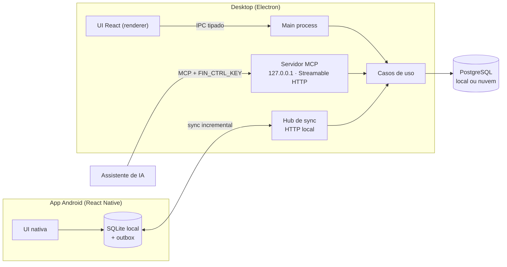

## Arquitetura em camadas

A regra de dependência aponta sempre para dentro: o domínio não conhece nada de fora.
Persistência e notificação entram por **portas** (interfaces) e têm adaptadores intercambiáveis.

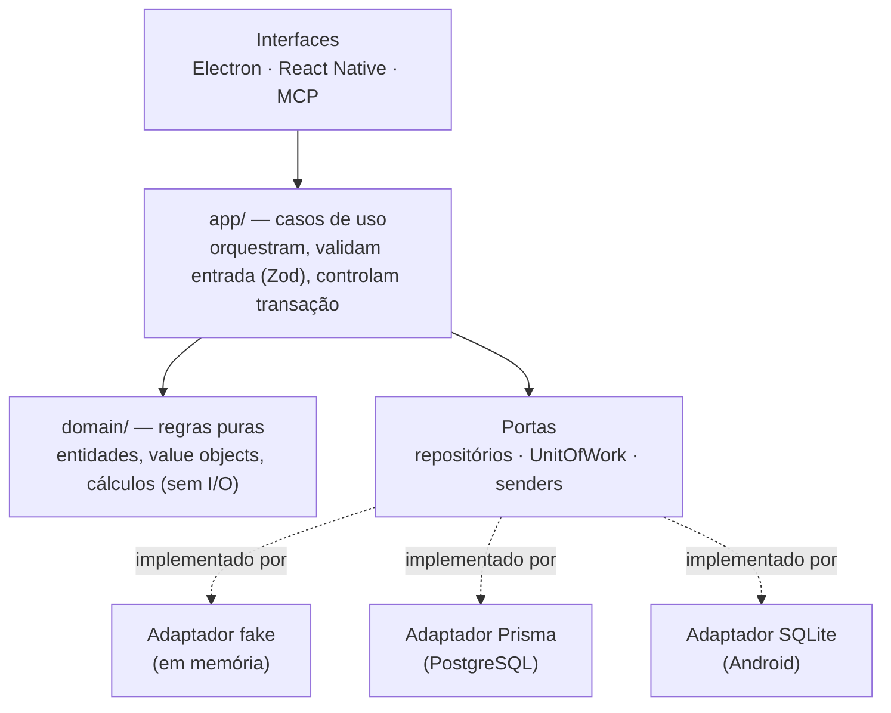

| Camada | Conteúdo | Neste repositório |
|---|---|---|
| `src/domain` | Entidades e regras puras (dinheiro, saldo, recorrência, previsão, cartão) | ✅ |
| `src/app` | ~500 arquivos: um caso de uso + um schema de entrada por operação | ✅ |
| `src/database/fake` | Adaptador em memória usado pelos testes de caso de uso | ✅ |
| `src/database/{prisma,sqlite}` | Adaptadores reais, mappers e migrações | privado |
| `src/react`, `src/react-native`, `src/mcp` | Interfaces (desktop, Android, MCP) | privado |

## Decisões de engenharia

- **Casos de uso pequenos e isolados**: cada operação tem seu `*.use.case.ts` e seu `*.input.schema.ts`
  (validação na borda com Zod), o que facilita testar, expor via MCP e reaproveitar no Android.
- **Dinheiro em centavos inteiros**: sem erro de ponto flutuante.
- **Unit of Work**: operações que tocam várias entidades (transferência, pagamento de fatura, parcelas)
  são atômicas, com **bloqueio otimista** por versão contra edição concorrente.
- **Mesma suíte, vários adaptadores**: os testes de contrato rodam contra o fake e contra o Postgres real.
- **Local-first com sync**: o app Android grava num SQLite local e registra mudanças por *trigger* numa
  outbox; o desktop aplica de forma idempotente e resolve conflitos.
- **Pré-registro com deduplicação por conteúdo**: lançamentos vindos do celular passam por aprovação
  e não duplicam.
- **Desenvolvimento orientado a especificação** (GitHub Spec Kit): ~30 specs com plano e tarefas;
  os comentários do código citam a spec que justifica cada regra.

## Fluxo: do celular ao assistente de IA

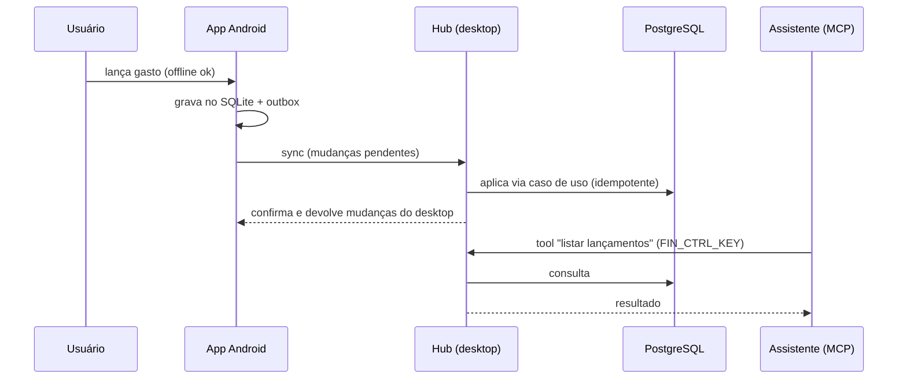

## Modelo de dados (resumo)

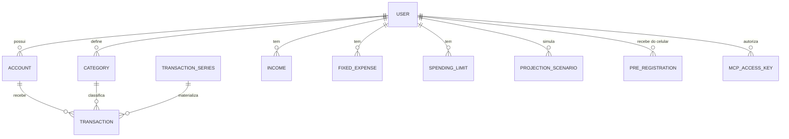

O schema completo está em [prisma/schema.prisma](prisma/schema.prisma).

## Testes

```bash
npm install
npm test            # node:test — domínio e casos de uso
npm run typecheck   # tsc --noEmit
```

Neste recorte: **1213 testes** de domínio e casos de uso, todos verdes, com typecheck limpo. No
repositório completo são ~2500 `node:test` mais uma suíte e2e com Playwright sobre o app Electron real.

## Stack

TypeScript · Node · Electron · React · React Native / Expo · PostgreSQL · Prisma · SQLite · Zod ·
Model Context Protocol (SDK oficial) · Fastify · Playwright · electron-builder (AppImage, Flatpak) · APK assinado.

## Contato

**Marco Aurélio Tôrres Vieira** — aberto a conversar sobre o produto, licenciamento ou oportunidades.
