# Assistente Fin

**Assistente Fin** é um assistente financeiro pessoal **local-first**: um app **desktop (Electron)**, um **app Android** que
sincroniza com o desktop e um **servidor MCP** para assistentes de IA operarem os dados.
O usuário é dono dos dados: tudo roda sobre um PostgreSQL próprio, sem servidor de aplicação.
Um **agente de IA embutido** conversa sobre as finanças, lê extratos e faturas, gera relatórios e propõe alterações
que só valem depois da aprovação — com os números sempre conferidos contra os dados reais.

> **Repositório de portfólio.** Esta é a vitrine pública: mostra a **arquitetura** e o **núcleo testado**
> (domínio e casos de uso), não o produto inteiro. O app completo (desktop, Android, MCP, sync, empacotamento)
> é comercializado e vive em repositório privado. Licença não comercial — veja [LICENSE](LICENSE).

## Em funcionamento


| Dashboard | Extrato |
|---|---|
|  |  |
| **Limites de gasto** | **Gastos fixos** |
|  |  |
| **Cartão de crédito** | **Projeções** |
|  |  |

### Agente de IA

| Pergunta com resposta conferida | Pede acesso à pasta (uma única ação) |
|---|---|
| 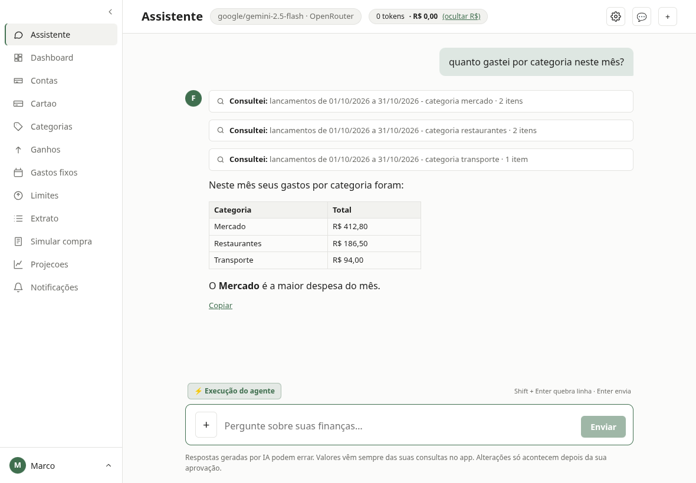 | 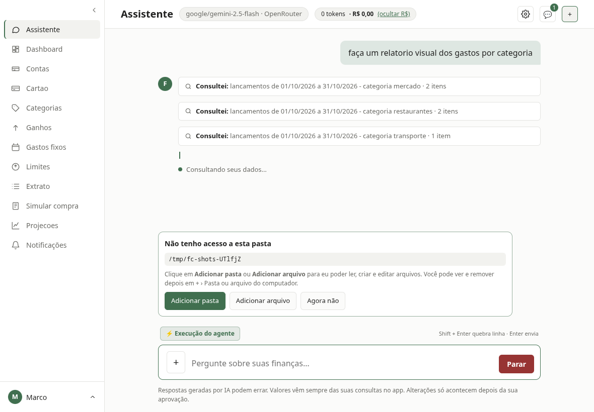 |
| **Relatório salvo no computador** | **O `.html` gerado (gráfico em SVG, abre offline)** |
| 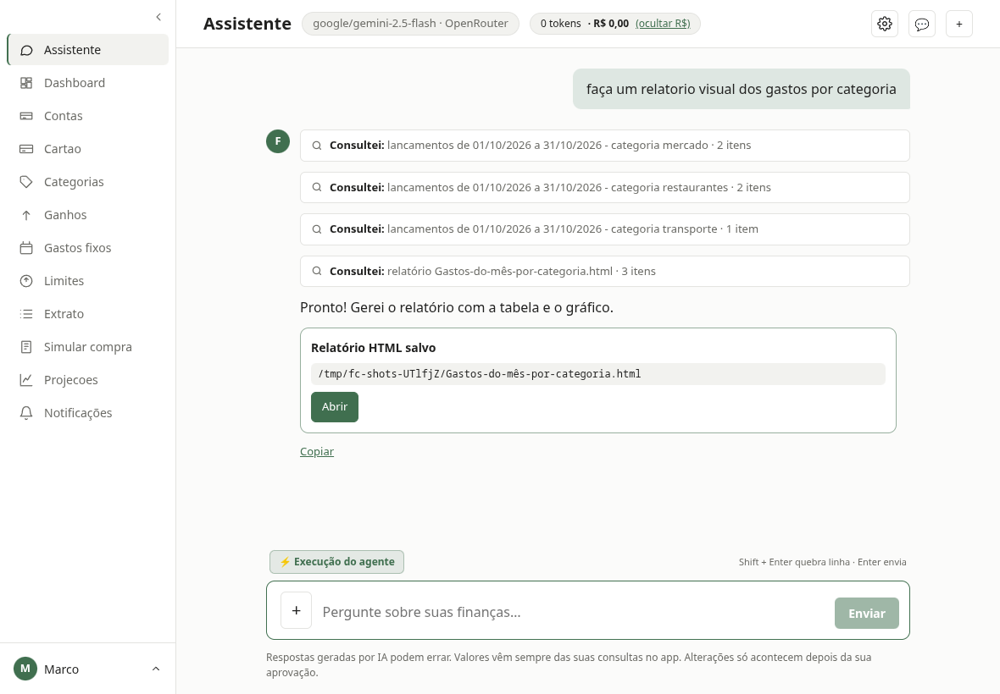 | 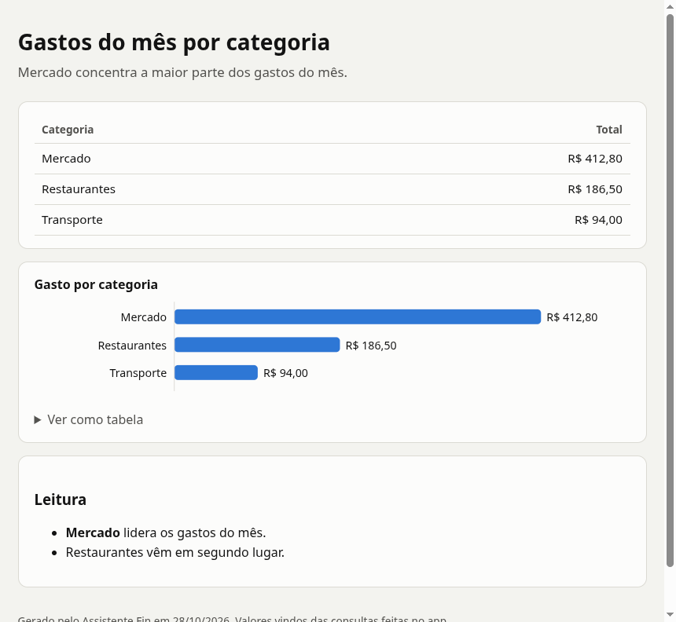 |

Capturas do app real com um servidor de LLM de teste: as consultas (cartões "Consultei"), os números e os arquivos são os do app;
só o texto do modelo é roteirizado.

### App Android

<p align="center">
  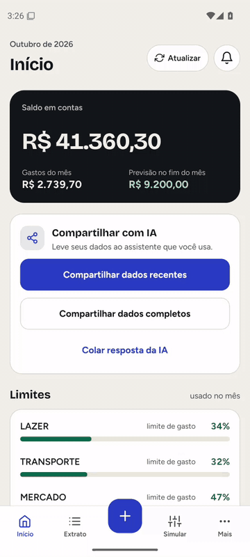
  &nbsp;
  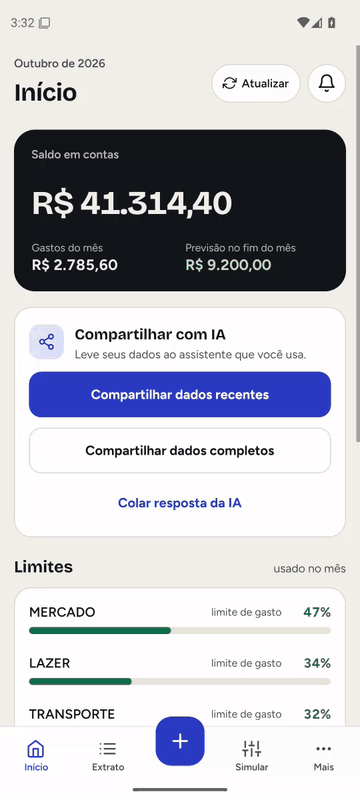
</p>

| Início | Limites | Extrato | Simular compra | Mais |
|---|---|---|---|---|
| 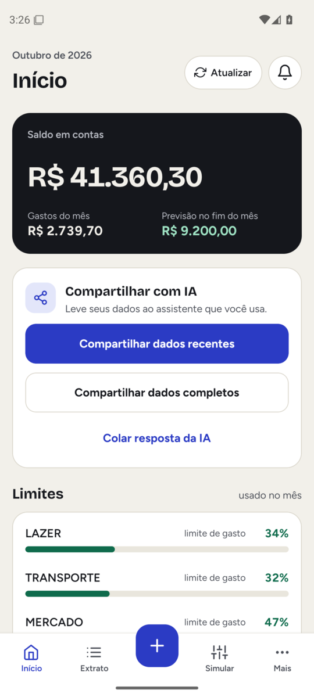 | 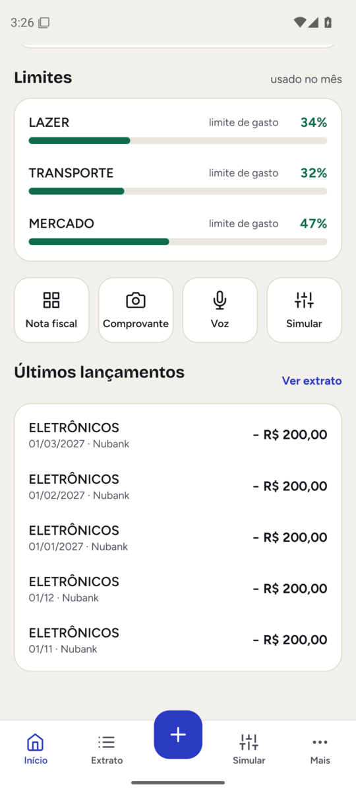 | 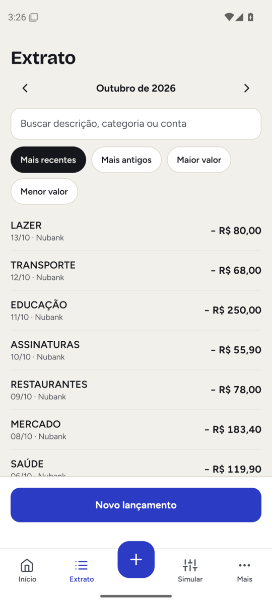 | 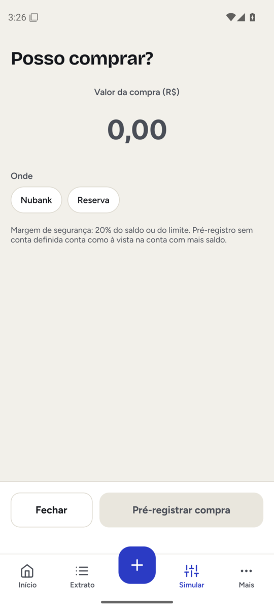 | 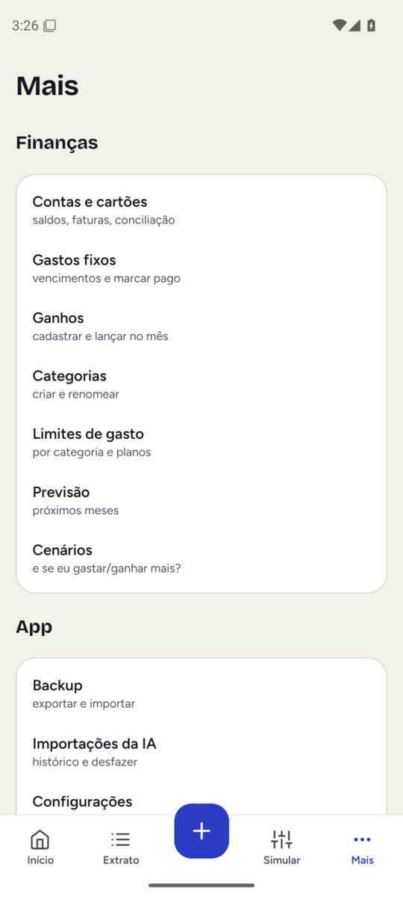 |

O app roda sincronizado com o desktop (mesmos saldos, limites e lançamentos) e funciona offline.
Vídeo do tour: [android-tour.mp4](docs/media/android-tour.mp4).

### Servidor MCP (assistente de IA operando o app)

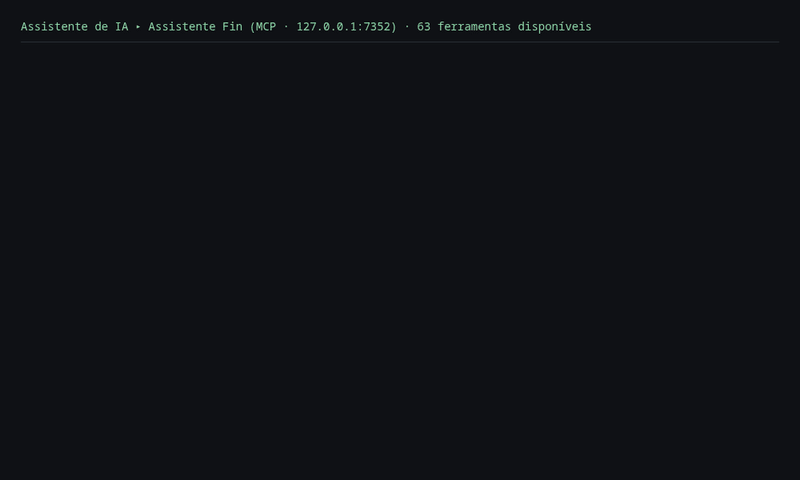

Sessão real contra o servidor MCP embutido no desktop (63 ferramentas, HTTP local, autenticado por chave),
rodando sobre um banco de teste descartável: o assistente consulta os limites, lança um gasto e simula uma compra.
As perguntas são ilustrativas; as chamadas e as respostas são as do servidor. O lançamento criado pelo MCP
aparece na hora no extrato do desktop:

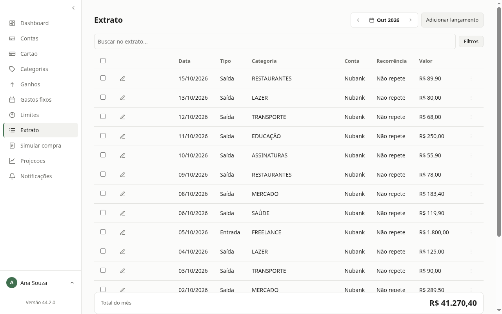

## O que o produto faz

- **Desktop**: contas, ganhos, gastos fixos, cartões com compras parceladas, limites de gasto,
  categorias (renomear propaga), recorrência com materialização, previsão mensal adaptativa,
  simulação de compra, cenários com pontos de restauração, backup, multiusuário por CPF.
- **Android**: lançamento rápido, pré-registro (comprovantes, NFC-e), widgets e atalhos, sync com o desktop.
- **MCP embutido**: assistentes de IA consultam e lançam dados por HTTP local, autenticados por chave.
- **Agente de IA no chat** (desktop e celular): perguntas em linguagem natural sobre os dados, com a **resposta conferida** — todo
  valor citado precisa ter vindo de uma consulta; o que não conferir é ocultado. Veja a seção "Agente de IA".
- **Troca de dados com agentes de IA**: exporta/importa blocos estruturados, sem expor o banco.
- **Segurança**: códigos de verificação cifrados em repouso (AES-256-GCM), chaves de acesso por usuário.

## Visão geral do sistema

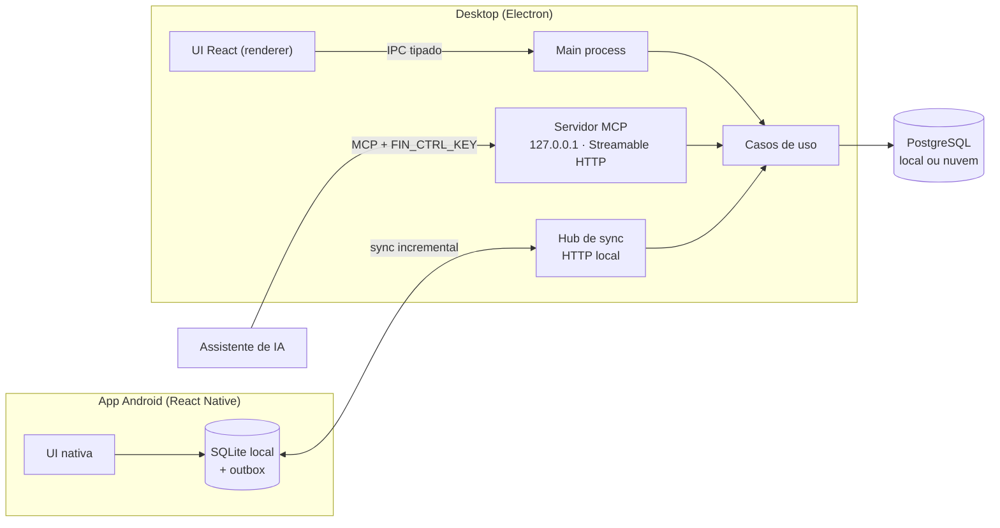

## Agente de IA

O agente roda como um **grafo de nós** declarado como dado (rota → raciocínio com ferramentas → resposta verificada), sobre portas
(`LlmPort`, `ToolPort`, armazenamento), com modelo em **3 níveis** (alto/médio/básico) em OpenRouter, Google Gemini ou Ollama local.
Visão técnica completa em [docs/agent/README.md](docs/agent/README.md).

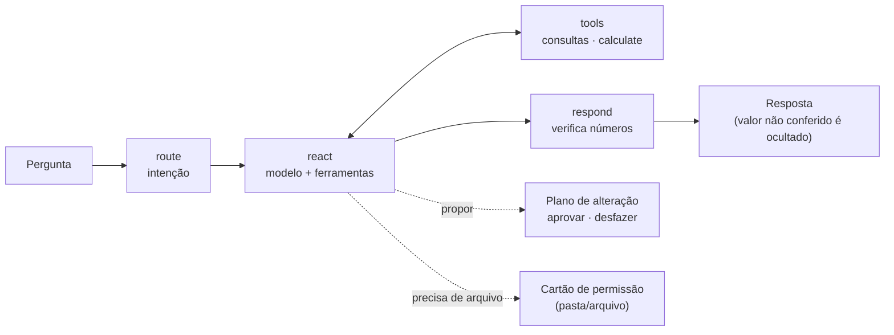

- **Números verificados**: um *livro-razão de fatos* guarda cada valor, data e quantidade devolvidos pelas ferramentas (e as figuras que
  o usuário escreveu); `verifyFigures` compara a resposta com ele e mascara o que não conferir. Contas passam por `calculate`.
- **Escrita só com aprovação**: o agente nunca grava direto. `propose_changes` cria um **plano** com antes/depois e alertas
  (duplicata, valor diferente do pedido, estouro de limite); aprovar aplica tudo numa transação, e dá para **desfazer** por 7 dias.
  Autonomia por tipo de ação (padrão desligada) e regras de categorização aprendidas com o uso.
- **Preferências e memória**: o agente guarda preferências ditas ou percebidas (com origem, privacidade e apagar tudo) e **compacta**
  conversas longas em segundo plano, sem valores em reais no resumo.
- **Capacidades dinâmicas**: se o app não resolve um pedido, o agente procura uma capacidade (servidor MCP remoto ou *skill*) e mostra
  um cartão com o que sai do aparelho; nada conecta antes da aprovação, e mudança de identidade bloqueia o uso até aprovar de novo.
- **Anexos e arquivos**: lê CSV, XLSX, PDF e imagens (extração local; só vai à nuvem com consentimento próprio) e, no desktop,
  **pastas do computador mediante permissão no chat** — `..`, links simbólicos e dados sensíveis são barrados, editar fora do git
  pede prévia, e todo conteúdo lido é tratado como **dado, nunca instrução** (marca de injeção).
- **Relatórios**: `write_report` monta `.html` autocontido (gráficos em SVG, tema claro/escuro, sem script) ou `.md`; **todo número do
  relatório é conferido contra as consultas** antes de gravar.
- **Várias conversas ao mesmo tempo**, com estado por conversa, notificação do desktop quando uma termina ou espera resposta, e menu
  da bandeja com os chats em andamento.
- **Qualidade medida**: avaliação de regressão com cenários sobre base sintética (exatidão, zero valores inventados, zero escritas
  indevidas) e telemetria de custo/tokens por nível de modelo.

## Arquitetura em camadas

A regra de dependência aponta sempre para dentro: o domínio não conhece nada de fora.
Persistência e notificação entram por **portas** (interfaces) e têm adaptadores intercambiáveis.

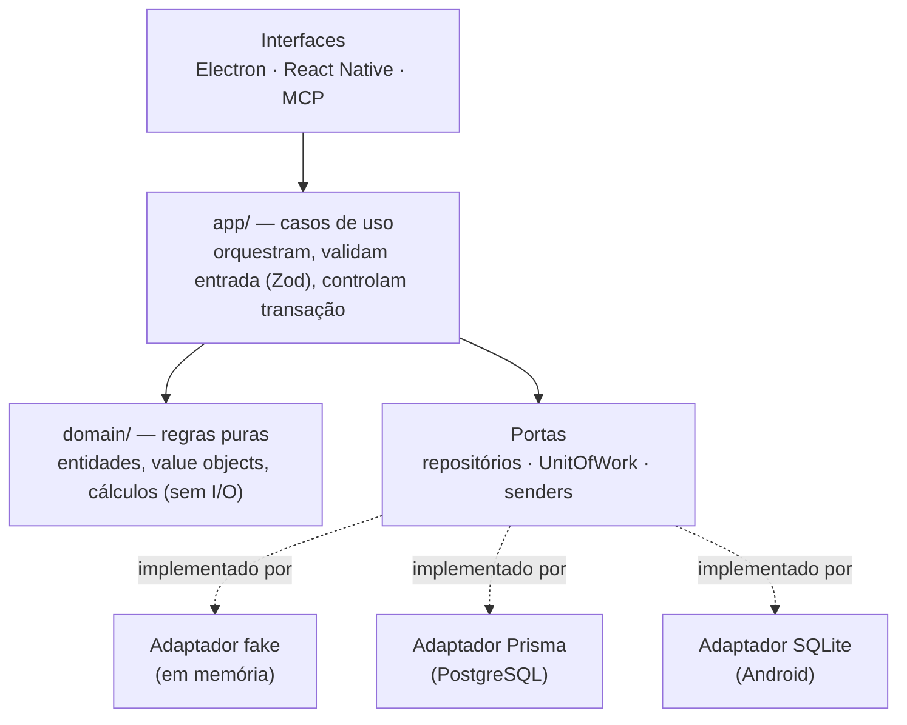

| Camada | Conteúdo | Neste repositório |
|---|---|---|
| `src/domain` | Entidades e regras puras (dinheiro, saldo, recorrência, previsão, cartão, **agente, planos, autonomia, preferências, capacidades**) | ✅ |
| `src/app` | ~1.100 arquivos: um caso de uso + um schema de entrada por operação, mais o **núcleo do agente** (`app/agent`: grafo, ferramentas, verificação, planos, memória, arquivos, relatórios) | ✅ |
| `src/composition` | Montagem dos casos de uso e do agente (injeção de dependências) | ✅ |
| `src/libs` | Adaptadores de plataforma sem I/O de banco: modelos (OpenAI-compatível, streaming SSE), leitura de PDF/planilha, disco, relógio, ids, criptografia | ✅ |
| `src/database/fake` | Adaptador em memória usado pelos testes de caso de uso (inclui os armazenamentos do agente) | ✅ |
| `src/database/{prisma,sqlite}` | Adaptadores reais, mappers e migrações | privado |
| `src/react`, `src/react-native`, `src/mcp` | Interfaces (desktop, Android, MCP) | privado |

## Decisões de engenharia

- **Casos de uso pequenos e isolados**: cada operação tem seu `*.use.case.ts` e seu `*.input.schema.ts`
  (validação na borda com Zod), o que facilita testar, expor via MCP e reaproveitar no Android.
- **Dinheiro em centavos inteiros**: sem erro de ponto flutuante.
- **Unit of Work**: operações que tocam várias entidades (transferência, pagamento de fatura, parcelas)
  são atômicas, com **bloqueio otimista** por versão contra edição concorrente.
- **Mesma suíte, vários adaptadores**: os testes de contrato rodam contra o fake e contra o Postgres real.
- **Local-first com sync**: o app Android grava num SQLite local e registra mudanças por *trigger* numa
  outbox; o desktop aplica de forma idempotente e resolve conflitos.
- **Pré-registro com deduplicação por conteúdo**: lançamentos vindos do celular passam por aprovação
  e não duplicam.
- **Desenvolvimento orientado a especificação** (GitHub Spec Kit): ~40 specs com plano e tarefas;
  os comentários do código citam a spec que justifica cada regra.
- **IA com guarda-corpos por construção**: ferramentas só de leitura por padrão (registros separados por efeito: consulta, memória,
  planejamento, externo, arquivo); modelo nunca vê `userId`; permissão de pasta só nasce de um clique na UI; resultado de ferramenta
  externa ou arquivo entra como dado, nunca como instrução.
- **Eventos como fonte da UI**: o estado do chat e das conversas em paralelo é uma função pura dos eventos do agente (`reduceChat`,
  `AgentActivityTracker`), o que torna o comportamento testável sem Electron.

## Fluxo: do celular ao assistente de IA

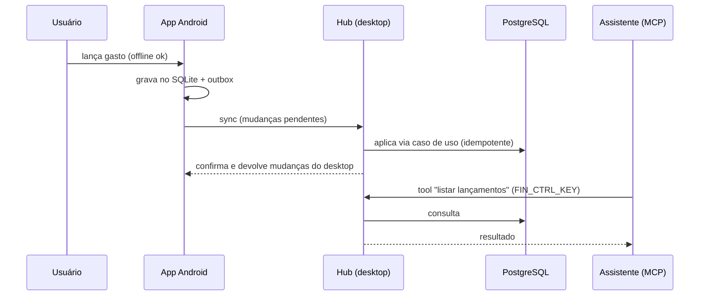

## Modelo de dados (resumo)

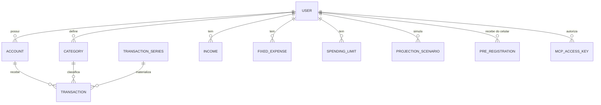

O schema completo está em [prisma/schema.prisma](prisma/schema.prisma).

## Testes

```bash
npm install
npm test            # node:test — domínio e casos de uso
npm run typecheck   # tsc --noEmit
```

Neste recorte: **2170 testes** de domínio, casos de uso e do **núcleo do agente** (grafo, ferramentas, verificação de números,
planos, permissão de arquivos, relatórios), todos verdes, com typecheck limpo. No repositório completo são ~5000 `node:test` mais
uma suíte e2e com ~210 cenários em Playwright sobre o app Electron real (com um servidor de LLM de mentira).

## Stack

TypeScript · Node · Electron · React · React Native / Expo · PostgreSQL · Prisma · SQLite · Zod ·
Model Context Protocol (SDK oficial) · agentes de IA (OpenRouter, Google Gemini, Ollama) · Fastify · Playwright ·
electron-builder (AppImage, Flatpak) · APK assinado.

## Contato

**Marco Aurélio Tôrres Vieira** — Senior Backend Engineer (Node.js/TypeScript, IA aplicada: MCP e agentes) · Belo Horizonte, MG

- GitHub: [github.com/maumenvi](https://github.com/maumenvi)
- LinkedIn: [Marco Aurélio Tôrres Vieira](https://www.linkedin.com/in/marco-aurélio-tôrres-vieira-294524b8)

Aberto a conversar sobre o produto, licenciamento ou oportunidades.


[](https://m8ven.ai/mcp/maumenvi-assistente-fin-evoh6m?s=readme)
