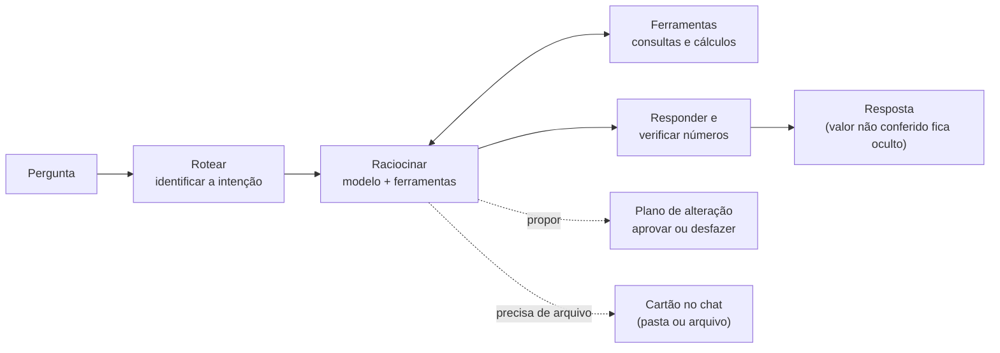
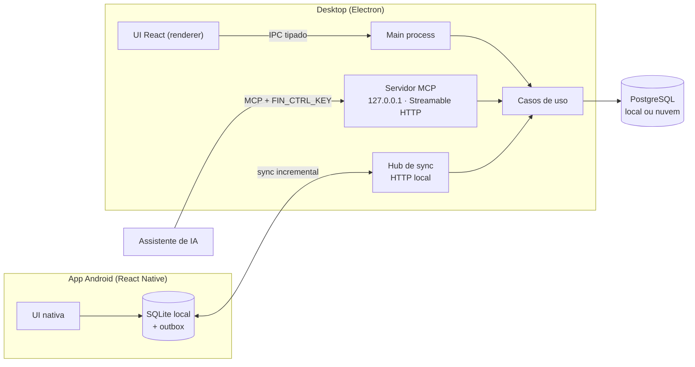
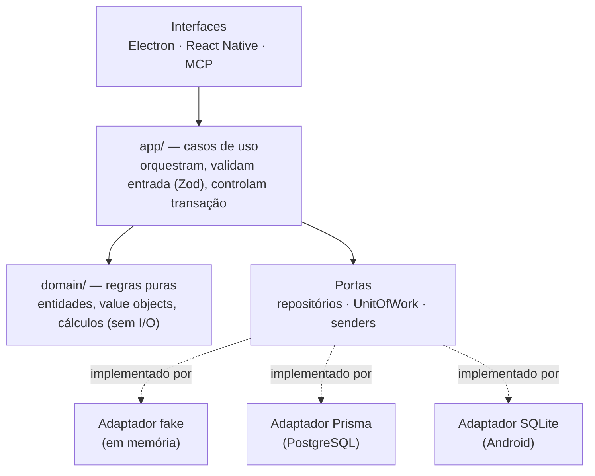
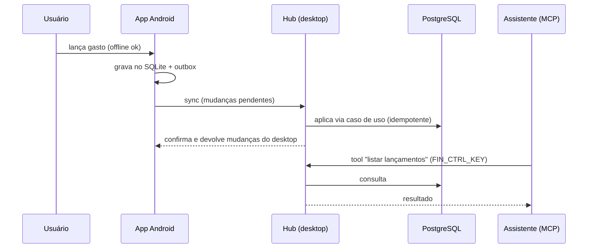
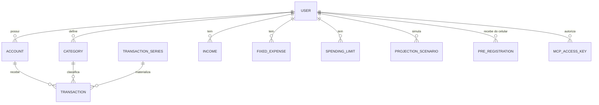

# Assistente Fin

**Assistente Fin** é um assistente financeiro pessoal **local-first**: um app **desktop (Electron)**, um **app Android** que
sincroniza com o desktop e um **servidor MCP** para assistentes de IA operarem os dados.
O usuário é dono dos dados: tudo roda sobre um PostgreSQL próprio, sem servidor de aplicação.
Um **agente de IA embutido** conversa sobre as finanças, lê extratos e faturas, gera relatórios e propõe alterações
que só valem depois da aprovação — com os números sempre conferidos contra os dados reais.

> **Repositório de portfólio.** Esta é a vitrine pública: mostra a **arquitetura** e o **núcleo testado**
> (domínio e casos de uso), não o produto inteiro. O app completo (desktop, Android, MCP, sync, empacotamento)
> é comercializado e vive em repositório privado. Licença não comercial — veja [LICENSE](LICENSE).

## Agente de IA

O diferencial do produto é um agente que **conversa sobre as suas finanças sem inventar números e sem alterar nada sem a sua
aprovação**. Funciona no desktop e no celular, com o modelo que você escolher: OpenRouter, Google Gemini ou Ollama (local). No modo
"somente local", nada sai do computador. A visão técnica completa está em [docs/agent/README.md](docs/agent/README.md).

| Pergunta com resposta conferida | Pede acesso à pasta (uma única ação) |
|---|---|
|  |  |
| **Relatório salvo no computador** | **O `.html` gerado (gráfico em SVG, abre offline)** |
|  |  |

Capturas do app real com um servidor de LLM de teste: as consultas (cartões "Consultei"), os números e os arquivos são os do app;
só o texto do modelo é roteirizado.

### Estratégia

A ideia central: **o modelo decide o que consultar; o código garante o que vale.** O modelo escolhe as ferramentas e escreve a
resposta. Buscar dados, calcular, conferir números, gravar e liberar acessos fica por conta de código determinístico e testado.



- **Fluxo declarado como dado.** Os nós (`route`, `react`, `tools`, `respond`) e as ligações entre eles são validados na montagem, e o
  diagrama é gerado do próprio código. Um único executor controla orçamento, cancelamento, retomada e o registro de cada passo.
- **Primeiro a intenção.** Regras simples classificam o pedido (consulta, preferência ou alteração); o modelo rápido só desempata.
  Cada intenção enxerga apenas as suas ferramentas: um pedido de consulta nunca grava, e um de preferência nunca lê dados.
- **Ferramentas pequenas e tipadas.** As consultas usam os mesmos casos de uso das telas. Somas, variações e projeções passam por
  `calculate` e `compare_periods`: o modelo não faz contas.
- **Três níveis de modelo.** A cada passo o agente escolhe entre alto, médio e básico, olhando o custo. Se o principal falhar, entra o
  modelo alternativo, e o custo em tokens é medido por nível.
- **Propor e só depois confirmar.** Toda escrita vira um plano que você revisa (antes e depois, com alertas) e que é aplicado numa
  única transação.
- **Contexto sob controle.** As suas preferências entram no prompt. Conversas longas são resumidas em segundo plano (a partir de 70%
  da janela do modelo; 50% nos modelos locais pequenos), e o resumo não guarda valores em reais: eles são sempre consultados de novo.
- **Orçamento por pedido.** Cada pedido tem limite de passos, tempo, custo e tokens. Ao estourar, o agente entrega o que já apurou e
  oferece **Continuar** de onde parou. Até 5 conversas rodam ao mesmo tempo, e o desktop avisa quando uma termina ou precisa de você.
- **Qualidade medida.** Uma suíte de avaliação, com dados sintéticos, mede exatidão, valores inventados e escritas indevidas. Ela
  também roda com um prompt propositalmente piorado, para provar que os testes detectam a piora.

### Guardrails (proteções)

| Risco | Como é evitado |
|---|---|
| **Número inventado** | Um registro guarda cada valor, data e quantidade que as ferramentas devolveram, mais os números que você mesmo escreveu. A resposta é conferida contra ele, e o que não bater **fica oculto**, depois de uma tentativa automática de correção. O período consultado e a contagem de itens também contam como fatos. |
| **Alteração indevida** | O agente **nunca grava direto**: só propõe um plano. Aprovar é um clique seu. Itens que mudaram desde a proposta são pulados, o plano vence em 24 horas e dá para **desfazer** em até 7 dias. A autonomia **começa desligada** e tem teto de valor e de quantidade. Excluir, transferir e pagar fatura **sempre** pedem aprovação, e itens vindos de anexos nunca são aprovados sozinhos. |
| **Vazamento entre usuários** | O `userId` vem **da sessão**, nunca do modelo nem do formato da ferramenta. A montagem recusa qualquer ferramenta que aceite esse campo. |
| **Ferramenta com poder demais** | As ferramentas são separadas por **tipo de efeito** (consulta, memória, planejamento, externa e arquivo). Cada intenção recebe só o seu conjunto, e cada conjunto recusa ferramentas de outro tipo. |
| **Instruções escondidas em conteúdo** | O texto de anexos, arquivos e ferramentas externas entra sempre como **dado**, nunca como instrução. Trechos que tentam dar ordens são marcados e aparecem na tela de execução. |
| **Serviços externos (MCP e *skills*)** | Nada se conecta antes da sua **aprovação**, num cartão que mostra o que sai do aparelho. As credenciais vão direto para o cofre, nunca pelo chat. Se a identidade do serviço mudar, o uso é bloqueado até você aprovar de novo, e a saída de dados passa por um filtro. |
| **Acesso a arquivos** | A permissão **só nasce de um clique seu**: nenhuma ferramenta consegue concedê-la. São barrados `..`, links que apontam para fora, os dados do próprio app, `~/.ssh`, arquivos `.env` e pastas do sistema. Criar nunca sobrescreve; editar fora do git exige **aprovar uma prévia**. O histórico da execução guarda só o caminho, nunca o conteúdo. |
| **Privacidade** | Antes de enviar qualquer coisa à nuvem, o app pede consentimento, e um consentimento separado para anexos. O modo "somente local" bloqueia a nuvem, e preferências privadas nunca vão para modelos de nuvem. Segredos não aparecem em logs, no histórico dos passos nem no estado salvo. |
| **Relatório com dado falso** | O relatório chega como **dados**, nunca como HTML escrito pelo modelo. Todo número é conferido contra as consultas antes de salvar, todo texto é escapado, e o `.html` não tem scripts nem recursos externos. |
| **Execução fora de controle** | Há orçamento de passos, tempo, custo e tokens, limite de consultas por resposta e no máximo 5 execuções simultâneas. Você pode parar a qualquer momento, e execuções interrompidas por uma queda podem ser continuadas. |
| **Falha do provedor** | Os erros viram mensagens claras (chave recusada, crédito esgotado, sem rede). O app tenta de novo com espera crescente, usa o modelo alternativo e avisa qual deles respondeu. |

## Em funcionamento


| Dashboard | Extrato |
|---|---|
|  |  |
| **Limites de gasto** | **Gastos fixos** |
|  |  |
| **Cartão de crédito** | **Projeções** |
|  |  |

### App Android

<p align="center">
  
  &nbsp;
  
</p>

| Início | Limites | Extrato | Simular compra | Mais |
|---|---|---|---|---|
|  |  |  |  |  |

O app roda sincronizado com o desktop (mesmos saldos, limites e lançamentos) e funciona offline.
Vídeo do tour: [android-tour.mp4](docs/media/android-tour.mp4).

### Servidor MCP (assistente de IA operando o app)


Sessão real contra o servidor MCP embutido no desktop (63 ferramentas, HTTP local, autenticado por chave),
rodando sobre um banco de teste descartável: o assistente consulta os limites, lança um gasto e simula uma compra.
As perguntas são ilustrativas; as chamadas e as respostas são as do servidor. O lançamento criado pelo MCP
aparece na hora no extrato do desktop:


## O que o produto faz

- **Desktop**: contas, ganhos, gastos fixos, cartões com compras parceladas, limites de gasto,
  categorias (renomear propaga), recorrência com materialização, previsão mensal adaptativa,
  simulação de compra, cenários com pontos de restauração, backup, multiusuário por CPF.
- **Android**: lançamento rápido, pré-registro (comprovantes, NFC-e), widgets e atalhos, sync com o desktop.
- **MCP embutido**: assistentes de IA consultam e lançam dados por HTTP local, autenticados por chave.
- **Agente de IA no chat** (desktop e celular): você pergunta em linguagem natural e ele responde com base nos seus dados. Todo
  valor citado precisa vir de uma consulta; o que não conferir é ocultado. Veja a seção "Agente de IA".
- **Troca de dados com agentes de IA**: exporta/importa blocos estruturados, sem expor o banco.
- **Segurança**: códigos de verificação cifrados em repouso (AES-256-GCM), chaves de acesso por usuário.

## Visão geral do sistema



## Arquitetura em camadas

A regra de dependência aponta sempre para dentro: o domínio não conhece nada de fora.
Persistência e notificação entram por **portas** (interfaces) e têm adaptadores intercambiáveis.



| Camada | Conteúdo | Neste repositório |
|---|---|---|
| `src/domain` | Entidades e regras puras: dinheiro, saldo, recorrência, previsão, cartão e, do agente, **planos, autonomia, preferências e capacidades** | ✅ |
| `src/app` | ~1.100 arquivos: um caso de uso e um schema de entrada por operação, mais o **núcleo do agente** (`app/agent`: fluxo, ferramentas, verificação de números, planos, memória, arquivos e relatórios) | ✅ |
| `src/composition` | Montagem dos casos de uso e do agente (injeção de dependências) | ✅ |
| `src/libs` | Adaptadores de plataforma que não acessam o banco: conexão com modelos de IA (API compatível com OpenAI, com streaming), leitura de PDF e planilhas, disco, relógio, ids e criptografia | ✅ |
| `src/database/fake` | Adaptador em memória usado pelos testes de caso de uso, inclusive os armazenamentos do agente | ✅ |
| `src/database/{prisma,sqlite}` | Adaptadores reais, mappers e migrações | privado |
| `src/react`, `src/react-native`, `src/mcp` | Interfaces (desktop, Android, MCP) | privado |

## Decisões de engenharia

- **Casos de uso pequenos e isolados**: cada operação tem seu `*.use.case.ts` e seu `*.input.schema.ts`
  (validação na borda com Zod), o que facilita testar, expor via MCP e reaproveitar no Android.
- **Dinheiro em centavos inteiros**: sem erro de ponto flutuante.
- **Unit of Work**: operações que tocam várias entidades (transferência, pagamento de fatura, parcelas)
  são atômicas, com **bloqueio otimista** por versão contra edição concorrente.
- **Mesma suíte, vários adaptadores**: os testes de contrato rodam contra o fake e contra o Postgres real.
- **Local-first com sync**: o app Android grava num SQLite local e registra mudanças por *trigger* numa
  outbox; o desktop aplica de forma idempotente e resolve conflitos.
- **Pré-registro com deduplicação por conteúdo**: lançamentos vindos do celular passam por aprovação
  e não duplicam.
- **Desenvolvimento orientado a especificação** (GitHub Spec Kit): ~40 specs com plano e tarefas;
  os comentários do código citam a spec que justifica cada regra.
- **IA com proteções desde o projeto**: as ferramentas são só de leitura por padrão e ficam em conjuntos separados por tipo de efeito
  (consulta, memória, planejamento, externa e arquivo). O modelo nunca vê o `userId`, a permissão de pasta só nasce de um clique na
  interface, e o resultado de ferramentas externas e de arquivos entra como dado, nunca como instrução.
- **Eventos como origem do estado da interface**: o estado do chat e das conversas em paralelo é uma função pura dos eventos do agente
  (`reduceChat` e `AgentActivityTracker`), então o comportamento é testável sem abrir o Electron.

## Fluxo: do celular ao assistente de IA



## Modelo de dados (resumo)



O schema completo está em [prisma/schema.prisma](prisma/schema.prisma).

## Testes

```bash
npm install
npm test            # node:test — domínio e casos de uso
npm run typecheck   # tsc --noEmit
```

Neste recorte há **2.170 testes**, todos verdes e com typecheck limpo. Eles cobrem o domínio, os casos de uso e o **núcleo do agente**
(fluxo, ferramentas, verificação de números, planos, permissão de arquivos e relatórios). No repositório completo são cerca de 5.000
testes `node:test` e uma suíte e2e com ~210 cenários em Playwright, executados sobre o app Electron real com um servidor de IA simulado.

## Stack

TypeScript · Node · Electron · React · React Native / Expo · PostgreSQL · Prisma · SQLite · Zod ·
Model Context Protocol (SDK oficial) · agentes de IA (OpenRouter, Google Gemini, Ollama) · Fastify · Playwright ·
electron-builder (AppImage, Flatpak) · APK assinado.

## Contato

**Marco Aurélio Tôrres Vieira** — Senior Backend Engineer (Node.js/TypeScript, IA aplicada: MCP e agentes) · Belo Horizonte, MG

- GitHub: [github.com/maumenvi](https://github.com/maumenvi)
- LinkedIn: [Marco Aurélio Tôrres Vieira](https://www.linkedin.com/in/marco-aurélio-tôrres-vieira-294524b8)

Aberto a conversar sobre o produto, licenciamento ou oportunidades.


[](https://m8ven.ai/mcp/maumenvi-assistente-fin-evoh6m?s=readme)
