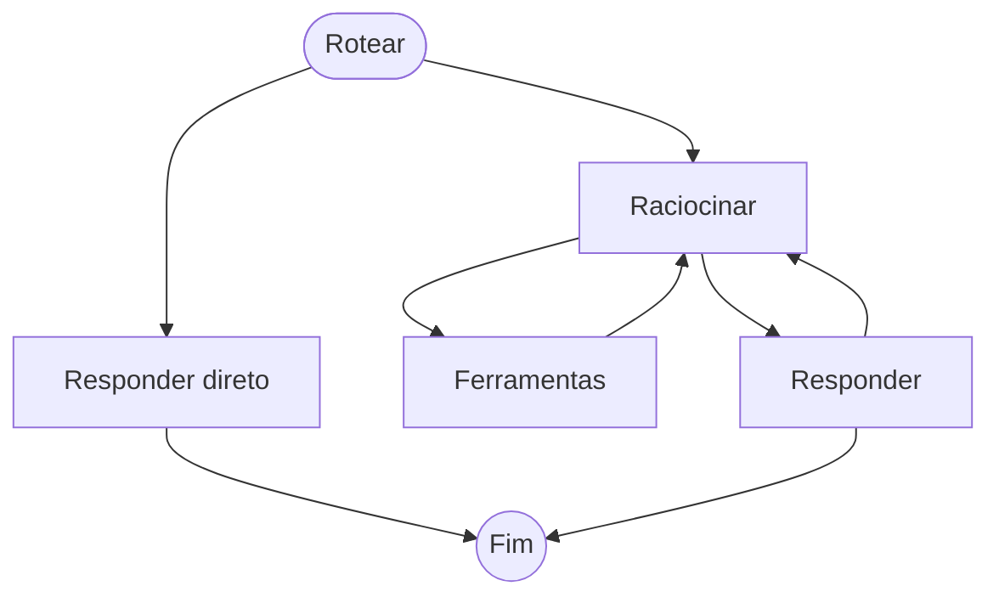

# Grafo do agente

> Gerado por `npm run agent:graph` a partir de `src/app/agent/graph/agent.graph.ts`. Não edite à mão.

| Nó | Rótulo | Vai para | Usa modelo | O que faz |
|---|---|---|---|---|
| `route` | Rotear | answer, react | modelo rápido, só se as regras forem inconclusivas | descobre a intenção do pedido (consulta, conversa, escrita, configuração, fora de assunto) |
| `answer` | Responder direto | END | modelo rápido só em conversa simples | responde sem consultar dados; pedidos de escrita, configuração e fora de assunto têm texto fixo |
| `react` | Raciocinar | tools, respond | modelo principal | raciocina e decide: pedir ferramentas ou responder; troca para o alternativo se o principal falhar |
| `tools` | Ferramentas | react | nenhum | executa as consultas em paralelo e alimenta o livro-razão de fatos |
| `respond` | Responder | react, END | nenhum | confere cada valor da resposta contra os fatos; corrige uma vez ou oculta o que não foi confirmado |
